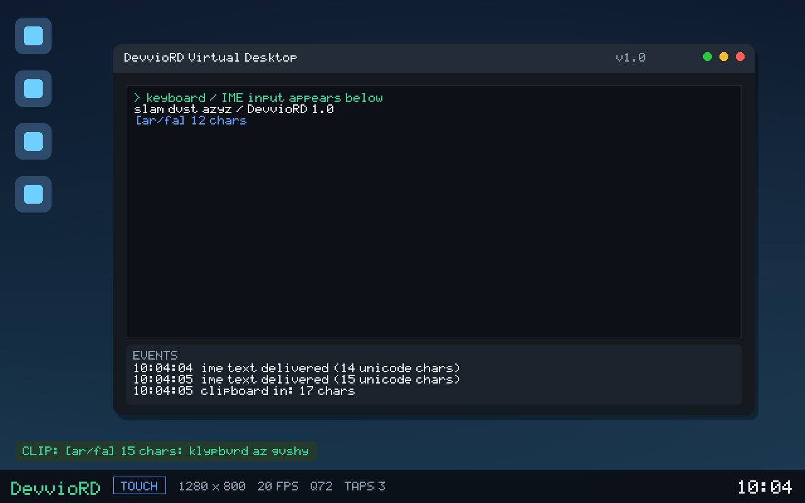

# DevvioRD — Remote Desktop برای اندروید

یک اپ ریموت دسکتاپ کامل و حرفه‌ای: **اپ اندروید** + **سرور هاست** + **کلاینت وب**.
انتقال فایل دوطرفه، کلیپ‌بورد دوطرفه، حالت لمسی و حالت موس، و پشتیبانی کامل از
کیبورد فارسی/عربی/CJK/ایموجی روی دسکتاپ مقصد.

A complete remote-desktop stack: an Android app, a self-contained host server and a
browser client. Two-way file transfer, two-way clipboard, touch and mouse modes, and
correct Unicode/IME keyboard input (Persian, Arabic, CJK, emoji).

---

## ۱. فایل نصبی اندروید

| فایل | توضیح |
| --- | --- |
| [`dist/DevvioRD-1.0.0.apk`](dist/DevvioRD-1.0.0.apk) | APK امضاشده (v1+v2+v3) · Android 5.0+ · ~65 KB |
| [`dist/DevvioRD-1.0.0.apk.sha256`](dist/DevvioRD-1.0.0.apk.sha256) | چک‌سام برای بررسی سالم بودن فایل |
| [`docs/TEST-REPORT.md`](docs/TEST-REPORT.md) | گزارش کامل تست‌ها (۲۰۳ بررسی، همه سبز) |

نصب: فایل APK را روی گوشی کپی کنید، «نصب از منابع نامشخص» را برای فایل‌منیجر یا
مرورگر فعال کنید و نصب کنید.

> این APK با کلید توسعه امضا شده است (برای توزیع در Play Store باید با کلید خودتان
> امضا شود؛ `app/devviord-release.jks` را بسازید تا بیلد از آن استفاده کند).

---

## ۱٫۵ نمونه تصویری



تصویر بالا خروجی واقعی `GET /snapshot.jpg` از بک‌اند `synthetic` است، بعد از سه
ضربه لمسی، متن فارسی از مسیر IME و کلیپ‌بورد گوشی — یعنی همان چیزی که در اپ و
کلاینت وب دیده می‌شود. بک‌اند `synthetic` یک دسکتاپ مجازی برای تست و پیش‌نمایش
رسم می‌کند و جایگزین دسکتاپ واقعی سیستم نیست؛ روی لینوکس با `xdotool`/`ffmpeg`
تصویر واقعی دسکتاپ ارسال می‌شود. متن غیرلاتین برای خوانایی با حروف لاتین و برچسب
`[ar/fa]` نمایش داده می‌شود. رابط کاربری خود اپ و کلاینت وب در تصویر نیست؛
[`docs/UI.md`](docs/UI.md) هر صفحه را توضیح می‌دهد.

---

## ۲. اجرای سرور

سرور یک فایل اجرایی مستقل است؛ هیچ وابستگی‌ای (نه Python، نه Node، نه Java) نیاز ندارد.

```bash
./devviord                 # حالت خودکار: اگر دسکتاپ واقعی پیدا شود، همان را به اشتراک می‌گذارد
./devviord --mode app      # دسکتاپ مجازی داخلی (برای سرور بدون نمایشگر)
./devviord --port 5900 --token 1234
```

هنگام اجرا، آدرس‌ها، توکن و یک **QR code** برای اتصال سریع گوشی چاپ می‌شود.

| فایل | پلتفرم |
| --- | --- |
| `dist/devviord-linux-amd64` | لینوکس x86-64 |
| `dist/devviord-linux-arm64` | لینوکس ARM64 (Raspberry Pi) |
| `dist/devviord-darwin-arm64` | مک (Apple Silicon) |
| `dist/devviord-windows-amd64.exe` | ویندوز ۱۰/۱۱ |

### اشتراک دسکتاپ واقعی (لینوکس/X11)

```bash
sudo apt install ffmpeg xdotool xclip   # ضبط تصویر، کنترل موس/کیبورد، کلیپ‌بورد
./devviord --mode desktop --token 1234
```

`--mode auto` (پیش‌فرض) خودش تشخیص می‌دهد: اگر `DISPLAY` و `ffmpeg` موجود باشند
دسکتاپ واقعی به اشتراک گذاشته می‌شود، وگرنه دسکتاپ مجازی داخلی اجرا می‌شود.

### گزینه‌های پرکاربرد

```text
--port / --addr     پورت (پیش‌فرض 5900)
--token             رمز دسترسی (اگر ندهید، خودکار ساخته می‌شود)
--no-auth           بدون رمز (فقط شبکه مطمئن)
--mode              auto | desktop | app
--quality           ۲۰..۹۵ (کیفیت JPEG)
--fps               ۱..۶۰
--scale             ۰.۲۵..۱.۰ (کوچک‌کردن تصویر برای اینترنت کند)
--files             پوشه انتقال فایل (پیش‌فرض ~/DevvioRD/Downloads)
--pair-public       گذاشتن توکن داخل QR (فقط شبکه مطمئن)
--list-backends     نمایش امکانات این سیستم
```

---

## ۳. امکانات

**تصویر و کنترل**
- استریم MJPEG روی WebSocket با پروتکل باینری سبک (بدون JSON در مسیر ویدیو)
- حالت **لمسی**: لمس مستقیم، درگ، اسکرول دو انگشتی، دابل‌تیپ
- حالت **موس**: کشیدن = حرکت نشانگر (مثل تاچ‌پد)، ضربه = کلیک، دابل‌تیپ = دابل‌کلیک
- تنظیم زنده کیفیت/فریم/مقیاس، چهار پیش‌تنظیم، آمار fps و RTT، قطع و اتصال
  مجدد **خودکار با شمارش معکوس**، حالت تمام‌صفحه واقعی
- کلاینت وب با نشانگر کیفیت اتصال و توقف خودکار دریافت وقتی تب مخفی است
- رمزنگاری اختیاری `wss://` (پشت reverse proxy مثل nginx/Caddy)

**رابط کاربری**
- اپ اندروید و کلاینت وب از یک زبان طراحی (پالت، مقیاس تایپ، شبکه ۴dp) استفاده
  می‌کنند؛ هر صفحه در [`docs/UI.md`](docs/UI.md) توضیح داده شده است.
- صفحه اتصال با چسباندن آدرس، اسکن QR و تاریخچه؛ ورودی هرگز از دست نمی‌رود.
- صفحه فایل‌ها با ردیف‌های واقعی، مرتب‌سازی پوشه‌ها اول و آپلود قابل ادامه.
- تنظیمات با پیش‌تنظیم + خلاصه زنده پهنای باند؛ راهنمای جستجوپذیر درون‌برنامه‌ای.

**کیبورد (مهم‌ترین بخش)**
- ورودی از IME اندروید گرفته و به‌صورت **متن UTF-8** ارسال می‌شود؛ بنابراین فارسی،
  عربی، چینی، ایموجی و پیش‌بینی‌های کیبورد درست به مقصد می‌رسند
- Backspace/Enter/Tab/جهت‌ها و ترکیب‌های Ctrl/Alt/Super هم پشتیبانی می‌شوند
- کیبورد بلوتوث/فیزیکی هم کار می‌کند
- الگوریتم diff افزایشی (`ImeBridge`) تا حتی در متن‌های طولانی تایپ روان بماند

**کلیپ‌بورد**
- گوشی → سرور: دکمه ⎘ (یا ∞ از منو)
- سرور → گوشی: دکمه ⤓؛ تغییرات کلیپ‌بورد سرور خودکار روی گوشی کپی می‌شود
- در سرور: `xclip`/`xsel`/`wl-clipboard` اگر نباشند، کلیپ‌بورد داخلی استفاده می‌شود

**انتقال فایل**
- آپلود گوشی → سرور در چانک‌های ۱ مگابایتی با قابلیت ادامه (resumable)
- دانلود سرور → گوشی در `Downloads/DevvioRD`
- ساخت پوشه، تغییر نام، حذف، نام فایل فارسی، فایل صفر بایتی و فایل‌های چندگیگابایتی
- محافظت کامل در برابر path traversal (`../`)

**سایر**
- کلاینت وب داخلی (بدون نصب، از مرورگر گوشی یا کامپیوتر)
- QR code اتصال + deep link `devviord://connect?host=...&token=...`
- چند کلاینت همزمان، احراز هویت با توکن (مقایسه constant-time)

---

## ۴. ساخت از سورس

### اپ اندروید (بدون Gradle، بدون اینترنت)

```bash
python3 scripts/build_apk.py
# → dist/DevvioRD-1.0.0.apk  (aapt2 → ECJ → D8 → align → apksigner v1/v2/v3)
```

زنجیره ابزار در `toolchain/` قرار دارد (JDK، aapt2، android.jar، ECJ، D8، apksigner).
برای بازسازی روی ماشین دیگر: `scripts/fetch_toolchain.sh`.

### سرور

```bash
cd server && go build -o devviord ./cmd/devviord
# یا همه پلتفرم‌ها:
CGO_ENABLED=0 GOOS=windows GOARCH=amd64 go build -o devviord.exe ./cmd/devviord
```

---

## ۵. تست

همه تست‌ها روی همین ریپو اجرا شده‌اند: **۲۳۳ بررسی، همه سبز** (فاز ۱: ۲۰۳،
فاز ۲: ۳۰ بررسی و تست جدید). جزئیات و روش اجرا در
[`docs/TEST-REPORT.md`](docs/TEST-REPORT.md)؛ باگ‌های پیدا‌شده و رفع‌شده در
[`docs/BUGS.md`](docs/BUGS.md).

```bash
# منطق اپ اندروید روی JVM (پروتکل + IME + آدرس‌ها)   → 94 check
python3 scripts/jvm_tests.py

# پروتکل و استریم و ورودی و کلیپ‌بورد (WebSocket)   → 21 check
python3 scripts/integration_test.py --port 5900 --token secret123

# انتقال فایل (آپلود/دانلود/امنیت مسیر)            → 20 check
python3 scripts/files_test.py --port 5900 --token secret123

# کلاینت وب در jsdom (ویدیو، کیفیت، تب مخفی، QR)   → 72 check
node scripts/web_test.js --url http://127.0.0.1:5900 --token secret123

# صحت QR با دیکودر مستقل (OpenCV)                  → 3 payload
python3 scripts/qr_verify.py

# تست‌های واحد سرور (Go)                            → 49 test
cd server && go test ./...

# همان تست‌ها زیر آشکارساز مسابقه (race)             → 7 package
cd server && go test ./... -race

# ساختار و امضای فایل APK                            → 14 check
python3 scripts/verify_apk.py
```

---

## ۶. معماری

```text
اپ اندروید ─┐
کلاینت وب ──┼─ WebSocket (باینری) ─→ سرور Go ─┬─ capture: ffmpeg/x11grab | synthetic
            │   • فریم‌های JPEG             ├─ input:   xdotool (XTEST) | synthetic
            └─ REST (فایل/کلیپ‌بورد)        └─ clipboard: xclip/xsel/wl-clipboard | memory
```

| مسیر | توضیح |
| --- | --- |
| `server/internal/proto` | پروتکل باینری مشترک (۲۵ بایت رویداد لمس، هدر ۱۷ بایتی فریم) |
| `server/internal/capture` | بک‌اندهای ضبط تصویر + دسکتاپ مجازی (با رندر متن/موس/لاگ) |
| `server/internal/input` | تزریق ورودی (xdotool، نقشه‌برداری کلید/یونیکد) |
| `server/internal/files` | آپلود چانکی، مرور فایل، محافظت مسیر |
| `server/internal/server` | HTTP + WebSocket دست‌ساز (RFC 6455)، نشست‌ها، پمپ فریم |
| `server/internal/cli` | بنر شروع + تولید QR (پیاده‌سازی کامل ISO 18004) |
| `app/src/ai/devvio/rd` | اپ اندروید: `WsClient`, `RemoteView`, `ImeBridge`, `FilesActivity` … |
| `server/internal/server/web` | کلاینت وب داخلی |

جزئیات پروتکل: [`docs/PROTOCOL.md`](docs/PROTOCOL.md)
راهنمای کاربر: [`docs/USER-GUIDE.md`](docs/USER-GUIDE.md)

---

## ۷. امنیت

- توکن اجباری (خودکار ساخته می‌شود) با مقایسه constant-time
- مسیر فایل‌ها محصور در `--files` است؛ `..` مسدود می‌شود
- اندازه چانک آپلود و اندازه پیام WebSocket محدود است
- برای اینترنت: پورت را روی روتر باز کنید، `--token` قوی بگذارید و ترجیحاً پشت
  nginx با TLS (`wss://`) قرار دهید

## مجوز

MIT — فایل `LICENSE`.
